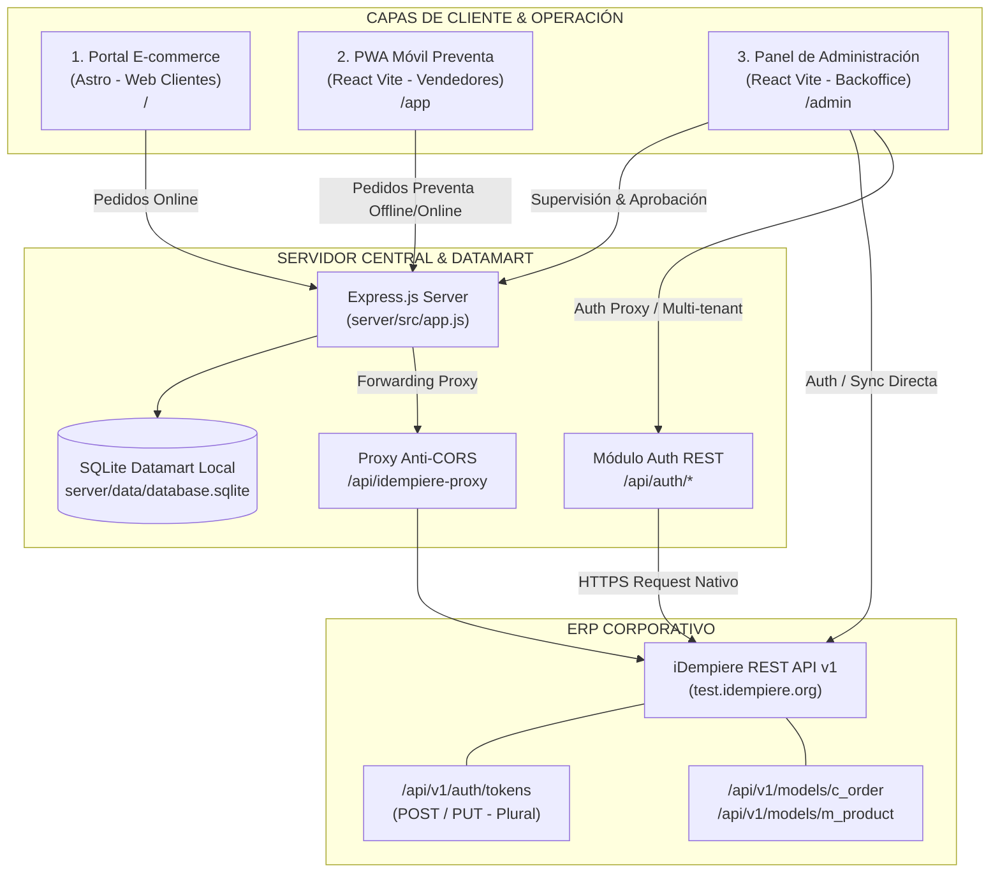

# 🍔 RapidFood ERP • Plataforma Comercial & Datamart

Plataforma de alta concurrencia para comida rápida gourmet (*Burger Factory* / *Tasty Bites Central*), desacoplada en **3 capas web y móviles** e integrada de forma nativa con **iDempiere ERP REST API v1** y un **Datamart SQLite de alto rendimiento (`better-sqlite3`)**.

---

## 🏛️ Arquitectura del Sistema (3 Capas + Datamart + ERP)



---

## 🚀 Módulos y Capas

1. **Capa E-commerce (`apps/ecommerce`)**:
   - Portal web en **Astro 4.x** (Zero-JS por defecto / Islands Architecture).
   - Catálogo de 10 hamburguesas de autor (*Rey de las Burgers, Burger Real Clásica, Burger Real Doble, Burger Doble Especial...*).
   - Modal interactivo de detalle, combos y cálculo nutricional.
   - Ruta de despliegue: `/`

2. **Capa PWA de Preventa (`apps/pwa`)**:
   - Aplicación móvil offline-first en **React 18 + Vite + Service Worker**.
   - Navegación por 4 pestañas: *Menú*, *Ofertas* (cupones `REY20`, `COMBO50`), *Órdenes* (seguimiento de cocina y estado ERP) y *Perfil* (nivel VIP Gold).
   - Conmutador dinámico en tiempo real para **Modo Claro** y **Modo Oscuro**.
   - Ruta de despliegue: `/app`

3. **Capa Panel de Control & Administración (`apps/admin`)**:
   - Backoffice en **React 18 + Vite**.
   - **Sidebar / Navbar colapsable**: Modo extendido (240px) y compacto (56px) con persistencia en `localStorage`.
   - Control de acceso iDempiere ERP: Modalidad 1 (Directo 1-Paso) y Modalidad 2 (Asistido 2-Pasos Multi-tenant).
   - Mantenimiento y sincronización bidireccional de catálogos SQLite &harr; iDempiere:
     - `M_Product_Category` (Categorías de Producto)
     - `M_Product` (Catálogo de Artículos)
     - `M_PriceList` / `M_ProductPrice` (Listas de Precios y Tarifas)
     - `C_BP_Group` / `C_BPartner` (Categorías y Clientes)
     - `C_Tax` (Tasas Tributarias - Modo Solo Lectura)
   - Bandeja unificada de pedidos 3 capas (`C_Order`) con auditoría de payloads JSON.
   - Inspector de sesión y tokens Bearer en tiempo real.
   - Ruta de despliegue: `/admin`

4. **Servidor Backend & Datamart (`server`)**:
   - Node.js + Express con motor **SQLite (`better-sqlite3`)** en modo WAL.
   - Proxy reverso anti-CORS (`/api/idempiere-proxy`).
   - Router `/api/auth` con cliente HTTPS nativo y fallback a Sandbox GardenWorld.

---

## ⚡ Comandos Rápidos

```bash
# 1. Instalar dependencias en todas las capas
npm run install:all

# 2. Compilar todas las aplicaciones y sincronizar en server/public
npm run build:all

# 3. Iniciar el servidor unificado en el puerto 3000
npm start
```

---

## 📚 Documentación Técnica Detallada

* 🤖 [AGENTS.md](file:///c:/Users/user21/laboratorio01/AGENTS.md): Reglas de oro de iDempiere REST API v1, convenciones de payload anidado (`parameters`, `organizationId`), protocolo de pruebas y bitácora de evolución v1.0 &rarr; v1.5.
* 🏛️ [ARCHITECTURE.md](file:///c:/Users/user21/laboratorio01/ARCHITECTURE.md): Diagramas de secuencia, mapeo relacional de entidades SQLite y modelos ERP (`C_Order`, `M_Product`, `C_Tax`), endpoints y pipeline Dokploy CI/CD.
